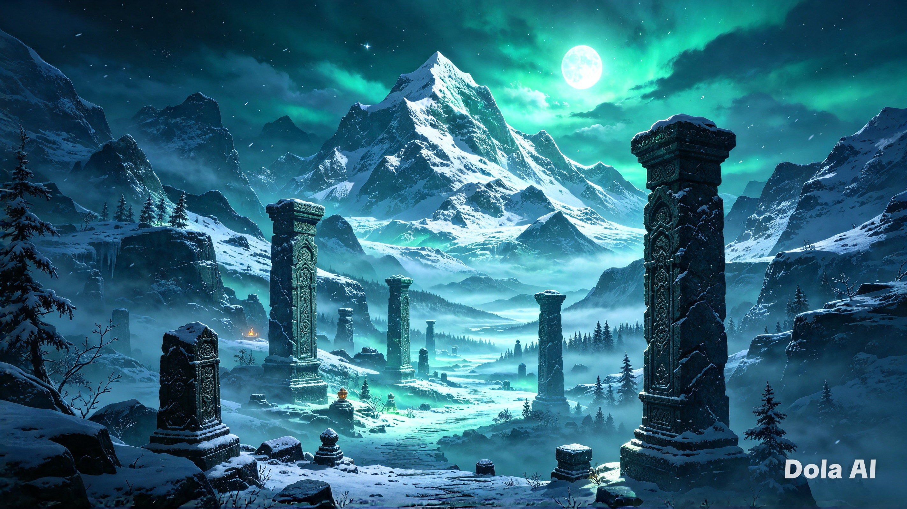
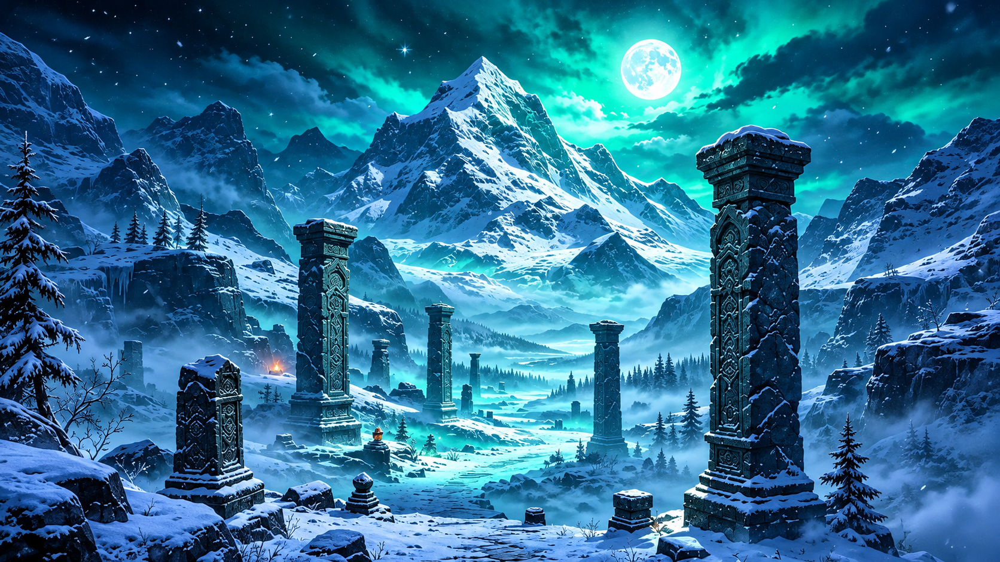

# Huy Bao Game — Bộ Công Cụ Xóa Overlay & Phục Hồi Video

[](https://www.gnu.org/licenses/agpl-3.0)
[](https://www.python.org/)
[](https://ffmpeg.org/)

Bộ công cụ dòng lệnh (CLI) xử lý và phục hồi các vùng bị che phủ (logo, watermark, thanh thông báo tĩnh) trên video bằng **FFmpeg**, **OpenCV** và **AI (LaMa)**.

> **Tuyên bố trách nhiệm & Giới hạn kỹ thuật:**
> * Chỉ sử dụng công cụ này cho các video thuộc quyền sở hữu của bạn hoặc video bạn được cấp phép chỉnh sửa hợp pháp.
> * Các thuật toán nội suy (`OpenCV Inpaint` và `LaMa AI`) chỉ tái tạo hoặc tổng hợp nội dung hợp lý về mặt thị giác, không thể khôi phục nguyên bản dữ liệu gốc nếu pixel đó bị che khuất trong mọi khung hình.

---

## 1. Bắt đầu nhanh (Quick Start)

Đảm bảo máy đã cài sẵn **FFmpeg**, sau đó sao chép và chạy ngay các lệnh dưới đây:

```bash
# 1. Cài đặt thư viện cơ bản
pip install -r requirements_v20.2.txt

# 2. Chạy thử nhanh 15 giây đầu bằng V18 (PC / Laptop thường)
python Huy_Bao_Game_v18.py input.mp4 preview.mp4 --preview-seconds 15

# 3. Xuất toàn bộ video bằng V18
python Huy_Bao_Game_v18.py input.mp4 output.mp4
```

*(Nếu dùng **V20.2** với ảnh mask PNG và AI LaMa trên máy mạnh, xem chi tiết ở mục 5B bên dưới).*

---

## 2. Minh họa hiệu quả (Before / After)

| Trước khi xử lý (Before) | Sau khi xử lý (After) |
| :---: | :---: |
|  |  |
| *Video gốc có dải trạng thái trên cùng và watermark ở vùng ROI* | *Đã làm sạch dải trên và phục hồi nền vùng watermark mượt mà* |

---

## 3. Kiến trúc & Chọn phiên bản phù hợp

Dự án cung cấp hai nhánh công cụ tối ưu cho hai cấu hình phần cứng khác nhau:

> **Khuyến nghị:** Sử dụng **`huy_bao_v20_2.py` (V20.2)** thay cho V20.1. V20.2 giữ nguyên thuật toán và tham số dòng lệnh của V20.1 nhưng đã khắc phục lỗi preset OpenCV và lỗi lệch kích thước đệm của LaMa. Bản `huy_bao_v20_1.py` được giữ lại làm bản lưu trữ dự phòng.

| Tiêu chí | V18 (`Huy_Bao_Game_v18.py`) | V20.2 (`huy_bao_v20_2.py`) |
| :--- | :--- | :--- |
| **Môi trường phần cứng** | Máy tính cá nhân (PC / Laptop CPU) | Máy trạm hiệu năng cao / Siêu máy tính (CPU đa nhân + GPU CUDA) |
| **Cách xác định vùng xóa** | Tô đen dải trên (`--top-height`) + lọc màu HSV tự động theo vùng `ROI` | Ảnh mặt nạ `--mask` PNG chuẩn từng pixel, lọc màu HSV hoặc kết hợp cả hai |
| **Thuật toán phục hồi** | Bộ lọc EMA thích nghi chuyển cảnh + `OpenCV Inpaint` (`telea` / `ns`) | Cửa sổ thời gian 2 chiều + `DIS Optical Flow` (tối ưu Bounding Box) + dự phòng `LaMa AI` |
| **Tốc độ & Tài nguyên** | Rất nhanh, nhẹ, phù hợp chạy hàng loạt | Chậm hơn, ưu tiên giữ chi tiết nền thật từ các khung hình lân cận |

### Cấu trúc kho lưu trữ

```text
├── Huy_Bao_Game_v18.py          # Phiên bản tiêu chuẩn chạy nhanh trên PC/Laptop
├── huy_bao_v20_2.py             # Phiên bản chất lượng cao đã sửa lỗi (khuyến nghị dùng)
├── huy_bao_v20_1.py             # Phiên bản V20.1 gốc (giữ làm dự phòng)
├── requirements_v20.2.txt       # Thư viện cơ bản (opencv-python-headless, numpy)
├── requirements-ai_v20.2.txt    # Thư viện AI tùy chọn cho V20.2 (Pillow)
├── requirements_v20.1.txt       # Thư viện cơ bản cho V20.1
├── requirements-ai_v20.1.txt    # Thư viện AI tùy chọn cho V20.1
├── tests/test_v20_2.py          # Bộ kiểm thử tự động cho V20.2
├── CHANGELOG.md                 # Lịch sử thay đổi
├── RELEASE.md                   # Ghi chú phát hành (Release Notes)
├── assets/                      # Thư mục chứa ảnh minh họa before.jpg / after.jpg
├── LICENSE                      # Toàn văn giấy phép AGPL-3.0
└── README.md                    # Tài liệu hướng dẫn sử dụng
```

---

## 4. Cài đặt môi trường chi tiết

### Bước 1: Cài đặt FFmpeg
Đảm bảo cả hai lệnh `ffmpeg` và `ffprobe` đã được cài đặt và thêm vào `PATH` của hệ thống:

```bash
# Trên Ubuntu / Debian
sudo apt update && sudo apt install -y ffmpeg python3 python3-venv python3-pip
```

### Bước 2: Cài đặt thư viện Python cơ bản (Dùng cho cả V18 và V20.2)

```bash
python3 -m venv .venv
source .venv/bin/activate
pip install --upgrade pip
pip install -r requirements_v20.2.txt
```

### Bước 3: Cài đặt tùy chọn AI LaMa (Chỉ dành cho V20.2 khi dùng cờ `--lama`)
Gói `simple-lama-inpainting` 0.1.2 khai báo ràng buộc cũ (`numpy<2`, `pillow<10`, `opencv-python`), nên nếu cài thông thường `pip` sẽ hạ cấp NumPy/Pillow và cài trùng thêm gói OpenCV. Hãy cài theo thứ tự sau để giữ sạch môi trường:

```bash
# 1. Cài PyTorch + torchvision phù hợp CUDA của máy (hoặc bản CPU):
pip install torch torchvision --index-url https://download.pytorch.org/whl/cpu

# 2. Cài phụ thuộc cơ bản và cài LaMa với --no-deps:
pip install -r requirements-ai_v20.2.txt
pip install --no-deps simple-lama-inpainting==0.1.2
```

*(Lưu ý: Khi chạy `pip check`, cảnh báo xung đột phiên bản của `simple-lama-inpainting` là bình thường. Chỉ nên giữ duy nhất **một** gói OpenCV là `opencv-python-headless` trong môi trường).*

---

## 5. Hướng dẫn sử dụng chi tiết

### A. Phiên bản V18 (`Huy_Bao_Game_v18.py` — Máy tính thường)

**1. Chạy thử nhanh (Preview 15 giây đầu):**

```bash
python Huy_Bao_Game_v18.py input.mp4 preview.mp4 --preview-seconds 15
```

**2. Tùy chỉnh vùng ROI, ngưỡng màu HSV và thuật toán Inpaint:**

```bash
python Huy_Bao_Game_v18.py input.mp4 output.mp4 \
  --top-height 110 \
  --roi 155 565 570 650 \
  --threshold 142 \
  --max-saturation 105 \
  --inpaint-method ns \
  --crf 18 \
  --preset medium
```

**3. Chỉ tô đen dải trên, bỏ qua bước Inpaint:**

```bash
python Huy_Bao_Game_v18.py input.mp4 output.mp4 --no-inpaint
```

#### Bảng tham số chính của V18

| Tham số | Mặc định | Ý nghĩa |
| :--- | :--- | :--- |
| `input` / `output` | *(Bắt buộc)* | Đường dẫn video đầu vào và tệp MP4 đầu ra. |
| `--top-height` | `110` | Chiều cao (pixel) tô đen ở mép trên khung hình. |
| `--no-clear-top` | `False` | Tắt tính năng tô đen dải trên. |
| `--no-inpaint` | `False` | Tắt bước dò mask và inpaint trên vùng `ROI`. |
| `--roi X1 Y1 X2 Y2` | `155 565 570 650` | Tọa độ vùng quét watermark (pixel). |
| `--threshold` | `142` | Ngưỡng độ sáng `V` tối thiểu trong hệ HSV (`0..255`). |
| `--max-saturation` | `105` | Ngưỡng độ bão hòa `S` tối đa trong hệ HSV (`0..255`). |
| `--dilate` / `--radius` | `2` / `4.0` | Độ giãn nở mask và bán kính nội suy. |
| `--inpaint-method` | `telea` | Thuật toán nội suy: `telea` (nhanh) hoặc `ns` (Navier-Stokes). |
| `--scene-cut-delta` | `24.0` | Ngưỡng thay đổi độ sáng ROI để reset nhanh bộ nhớ mask EMA. |
| `--crf` / `--preset` | `18` / `medium` | Chất lượng và tốc độ nén H.264 (`libx264`). |
| `--preview-seconds` | `0` | Chỉ xuất `N` giây đầu (`0` = xuất toàn bộ video). |

---

### B. Phiên bản V20.2 (`huy_bao_v20_2.py` — Máy trạm / Siêu máy tính)

#### Chuẩn bị ảnh Mask (`--mask`)
Tạo một ảnh `.png` thang độ xám có **đúng kích thước chiều rộng $\times$ chiều cao** của video gốc:
* **Màu trắng (`255`):** Vùng cần loại bỏ và phục hồi.
* **Màu đen (`0`):** Vùng giữ nguyên gốc.

**1. Chạy với ảnh Mask vẽ tay + DIS Optical Flow Ultra + LaMa AI:**

```bash
python huy_bao_v20_2.py \
  --input input.mp4 \
  --output restored.mp4 \
  --mask mask.png \
  --window 4 \
  --flow-quality ultra \
  --lama \
  --preset slow \
  --crf 16
```

**2. Kết hợp ảnh Mask tĩnh và bộ lọc màu HSV động:**

```bash
python huy_bao_v20_2.py \
  --input input.mp4 \
  --output restored.mp4 \
  --mask mask.png \
  --hsv-lower 20 100 150 \
  --hsv-upper 40 255 255 \
  --hsv-dilate 2 \
  --window 4 \
  --flow-quality ultra \
  --lama
```

**3. Chạy hoàn toàn tự động bằng màu HSV (không cần ảnh PNG mask):**

```bash
python huy_bao_v20_2.py \
  --input input.mp4 \
  --output restored.mp4 \
  --hsv-lower 20 100 150 \
  --hsv-upper 40 255 255 \
  --window 3 \
  --flow-quality medium
```

#### Bảng tham số chính của V20.2

| Tham số | Mặc định | Ý nghĩa |
| :--- | :--- | :--- |
| `--input` / `--output` | *(Bắt buộc)* | Đường dẫn video đầu vào và tệp MP4 đầu ra. |
| `--mask` | `None` | Ảnh PNG đen/trắng cùng kích thước video (`trắng = phục hồi`). |
| `--hsv-lower` / `--hsv-upper` | `None` | Dải màu `H S V` (`0..255`) để tạo mask tự động theo từng frame. |
| `--hsv-dilate` | `2` | Độ giãn nở của mask HSV. |
| `--window` | `4` | Số khung hình lân cận mỗi bên trong cửa sổ thời gian (`1..8`). |
| `--flow-quality` | `ultra` | Chất lượng DIS Optical Flow: `fast`, `medium`, `ultra`. |
| `--bbox-margin` | `48` | Lề ngữ cảnh (pixel) mở rộng quanh vùng Bounding Box của mask. |
| `--inpaint` | `telea` | Thuật toán OpenCV dự phòng: `telea` hoặc `ns`. |
| `--lama` | `False` | Bật mô hình AI LaMa cho các điểm ảnh chưa khôi phục được từ thời gian. |
| `--audio` / `--audio-bitrate` | `aac` / `192k` | Mã hóa âm thanh (`aac` tương thích rộng hoặc `copy` giữ nguyên gốc). |
| `--crf` / `--preset` | `16` / `slow` | Chất lượng và tốc độ nén `libx264`. |
| `--progress-every` | `30` | In tiến độ xử lý sau mỗi `N` khung hình (in ngay lập tức qua `flush`). |
| `--version` | — | Hiển thị thông tin phiên bản của công cụ. |

### C. Những nâng cấp & sửa lỗi chính trong V20.2 (so với V20.1)

* **Sửa lỗi hằng số DIS Optical Flow:** OpenCV chỉ hỗ trợ `ULTRAFAST`, `FAST` và `MEDIUM` (không có `DISOPTICAL_FLOW_PRESET_ULTRA`, gây lỗi ngay từ đầu khi tạo dictionary ánh xạ trong V20.1). Ở V20.2, mức `ultra` dùng preset `MEDIUM` kết hợp `25` vòng lặp gradient descent (`finestScale=0`).
* **Sửa lỗi kích thước đầu ra của LaMa:** `SimpleLama` tự động đệm ảnh đầu vào lên bội số của `8` pixel gây lệch mảng boolean khi ghép lại. V20.2 cắt ảnh đầu ra về đúng `(original_h, original_w)` trước khi gán.
* **Kiểm tra tham số sớm & Dọn dẹp an toàn:** Từ chối giá trị `--flow-quality` không hợp lệ trước khi tải mô hình AI; bắt tín hiệu `SIGTERM` để xóa sạch tệp tạm `*_v20_2_*.mp4` (mã thoát `130`); in log tiến độ theo thời gian thực (`flush=True`).

### D. Kiểm thử tự động (Unit Tests)

```bash
python -m unittest discover -s tests -v

# Chạy kèm kiểm thử suy luận LaMa thực tế:
HUY_BAO_TEST_LAMA=1 python -m unittest discover -s tests -v
```

---

## 6. Xử lý sự cố & Câu hỏi thường gặp (Troubleshooting & FAQ)

### Lỗi `Cần cài FFmpeg...` hoặc `'ffprobe' was not found`
* **Nguyên nhân:** Máy chưa cài FFmpeg hoặc thư mục chứa `ffmpeg` / `ffprobe` chưa được thêm vào biến môi trường `PATH`.
* **Cách khắc phục:**
  * **Linux/Ubuntu:** Chạy `sudo apt install -y ffmpeg`.
  * **Windows:** Tải bản build FFmpeg, giải nén và thêm đường dẫn thư mục `bin\` vào `System Environment Variables -> Path`, sau đó mở lại cửa sổ Terminal.

### Lỗi `ROI (155, 565, 570, 650) không hợp lệ với video ...`
* **Nguyên nhân:** Tọa độ `--roi X1 Y1 X2 Y2` mặc định của V18 vượt quá kích thước khung hình của video bạn đang xử lý (ví dụ video ngang `1280x720` hoặc video độ phân giải thấp hơn).
* **Cách khắc phục:** Kiểm tra độ phân giải thực tế của video và truyền lại tọa độ nằm trong kích thước ảnh (`0 <= X1 < X2 <= width`, `0 <= Y1 < Y2 <= height`).

### Lỗi `Mask is WxH, video is ...` ở V20.2 / V20.1
* **Nguyên nhân:** Ảnh `--mask` PNG không khớp chính xác từng pixel với chiều rộng và chiều cao của video gốc.
* **Cách khắc phục:** Resize ảnh mask về đúng độ phân giải của video đầu vào và đảm bảo vùng cần xóa tô màu trắng (`255`), vùng giữ nguyên tô màu đen (`0`).

### Lỗi `LaMa could not be initialized` hoặc `CUDA available: False`
* **Nguyên nhân:** Chưa cài gói `simple-lama-inpainting`, hoặc bản `PyTorch` hiện tại là bản chỉ chạy CPU / không khớp phiên bản driver CUDA của máy.
* **Cách khắc phục:**
  * Gỡ bản PyTorch cũ và cài lại đúng lệnh tương ứng với phiên bản CUDA tại [pytorch.org](https://pytorch.org/get-started/locally/), sau đó cài `simple-lama-inpainting==0.1.2` với `--no-deps`.
  * Nếu máy không có GPU NVIDIA, bạn vẫn có thể chạy V20.2 không cần cờ `--lama` (dùng fallback OpenCV `telea`/`ns`) hoặc dùng bản `Huy_Bao_Game_v18.py`.

### Vì sao V20.2 chạy chậm ngay cả khi đã có GPU?
* **Giải thích:** Thuật toán `OpenCV DIS Optical Flow` trong các bản cài đặt OpenCV tiêu chuẩn qua `pip` chạy hoàn toàn trên **CPU**; GPU CUDA chỉ tăng tốc bước suy luận của mô hình `LaMa`. Để tăng tốc trên video dài, bạn có thể giảm `--flow-quality medium` hoặc `--window 2`.

### Giới hạn đã biết trên cảnh tĩnh và camera chuyển động
* Trên cảnh camera đứng yên hoàn toàn, watermark tĩnh nằm cố định nên các khung hình lân cận không có pixel nền sạch để mượn; khi bật `--lama`, mô hình vẽ lại độc lập từng khung hình nên có thể gây nhấp nháy nhẹ cục bộ — nếu cần ổn định tuyệt đối trên cảnh tĩnh, hãy chạy không dùng `--lama`.
* `simple-lama-inpainting` sử dụng `torch.jit.load`; PyTorch có thể hiển thị cảnh báo tương thích trên Python 3.14+.

### Video xuất ra bị lệch tiếng nhẹ ở đoạn cuối (VFR)
* **Nguyên nhân:** Video quay màn hình điện thoại thường dùng tốc độ khung hình biến thiên (VFR), trong khi pipeline xuất chuẩn tốc độ khung hình cố định (CFR).
* **Cách khắc phục:** Nếu thấy cảnh báo VFR khi chạy V20.2, hãy kiểm tra lại đoạn cuối video hoặc dùng FFmpeg chuẩn hóa video nguồn về CFR trước khi xử lý.

---

## 7. Bản quyền & Giấy phép (Copyright & License)

Copyright © 2026 **Huy Bao Game** (`ghuy021112-cpu`).

Dự án này là phần mềm tự do, được phát hành theo giấy phép **GNU Affero General Public License v3.0 (AGPL-3.0)**:
* Bạn được tự do sử dụng, nghiên cứu, sửa đổi và phân phối lại mã nguồn với điều kiện giữ nguyên thông báo bản quyền của tác giả.
* Mọi bản sửa đổi, phái sinh hoặc triển khai cung cấp dịch vụ qua mạng đều **bắt buộc phải công khai toàn bộ mã nguồn** dưới cùng giấy phép **AGPL-3.0**.
* Xem toàn văn giấy phép tại tệp `LICENSE` trong kho lưu trữ hoặc tại [gnu.org/licenses/agpl-3.0](https://www.gnu.org/licenses/agpl-3.0).